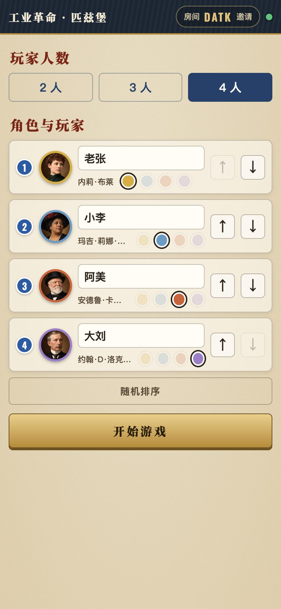
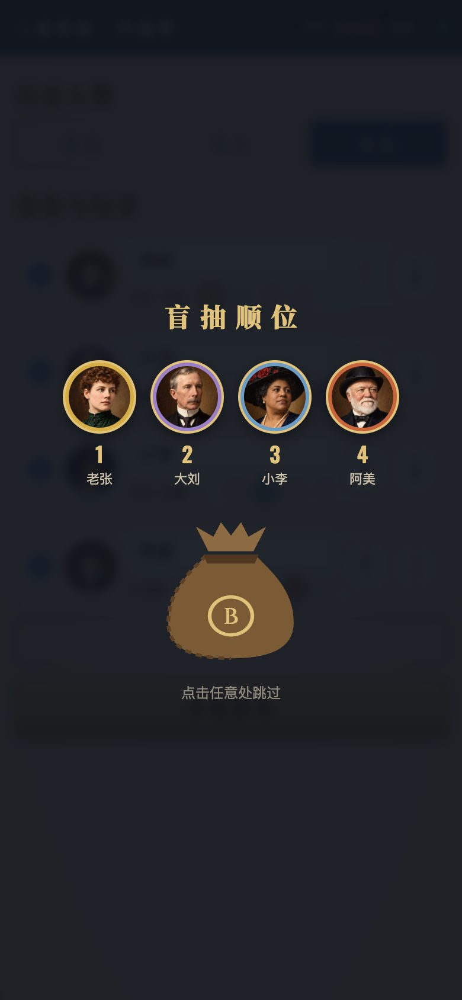

<div align="center">

# 匹兹堡开局小助手

**快速开局，计分不烧心**

《工业革命：匹兹堡》（Brass: Pittsburgh）线下对局的多人同步工具：排顺位、记花费、两时代计分、终局结算一站搞定。

一桌人用手机扫码进同一个房间，所有操作实时同步，无需下载、无需注册。

**[立即使用 → pgh.leisurecat.cloud](https://pgh.leisurecat.cloud)**


</div>

---

## 功能一览

### 开局：选人、选色、盲抽顺位

2–4 人局。每位玩家填名字、选颜色和角色，角色和颜色按实物板块绑定（黄：布莱 / 弗里克，蓝：特斯拉 / 沃克，橙：卡内基 / 比塞尔，紫：洛克菲勒 / 摩根）。点「随机排序」，所有手机同时播放盲抽袋动画，抽出首轮顺位。

<p>


</p>

### 对局：每轮记花费，自动排下一轮顺位

每轮输入每人花了多少钱，结算时按花钱从少到多排出下一轮顺位，同额保持原来的相对顺序（规则书 v2026.01）。两个时代各 8 轮自动推进，提示首轮只做 1 个行动、最后一轮不结算收入。结算错了可以撤销，断线重连自动追上进度。

<p>

</p>

### 计分：两个时代分开填，算式键盘

每个时代一张竖向计分表，一列一位玩家：计分条、铁路、产业、多相交流发电机、机车厂。铁路和产业逐项累加，数字键盘支持加减算式，合计实时更新。

<p>

</p>

### 结算：MVP、得分构成、成就，一键存长图

自动算出排名（同分先比收入等级、再比现金），展示 MVP、每人得分构成（行动分 / 铁路 / 产业 / 明珠）和 9 种趣味成就。终局时仍可修改玩家名，一键把整页结算生成长图，长按保存到相册。

<p>


</p>

### 往期对局

每局结束自动存档，可按玩家名、角色或房间码搜索，展开查看每人的得分明细。

<p>

</p>

### 新手教程与常见问题

9 分半规则讲解视频、23 节图文讲解，加上依据官方规则书整理的 31 条常见问题，新手开局前刷一遍就能上桌。

<p>


</p>

### 规则助手

每个页面右下角都有「规则」按钮，点开就能用中文问规则，比如花费相同怎么排顺位、石油城怎么用。助手用 DeepSeek V4.1 Flash（`deepseek-flash`）逐字回答，只依据本站的讲解稿和常见问题作答，资料里没有的不会乱编。Flash 过载、排队或出错时，依次改由备用模型回答（页面上不显示是哪个模型，服务端日志里有记录）：先是 Cloudflare Workers AI 上的 Qwen3.8 27B（`@cf/qwen/qwen3.8-27b`，不依赖 DeepSeek 的服务器），再是 DeepSeek V4 Pro（`deepseek-v4-pro`）。每个模型 9 秒内须开始回答，回答中途停顿超过 8 秒也会换下一个模型从头回答；都不行就提示稍后再问。另有每小时一次的定时检查（Cron Trigger）：DeepSeek 不通时，接下来一小时直接先用 Qwen，结果存在 KV 里。

<p>

</p>

---

## 技术实现

纯前端页面 + Cloudflare Workers，没有构建步骤，没有框架。

| 部分 | 说明 |
|---|---|
| `public/` | 页面静态资源：`index.html`、`app.js`、`style.css`、`img/`、教程页 `guide.html`、往期对局 `history.html` |
| `public/logic.js` | 规则与状态逻辑（顺位、计分、成就），页面和服务端共用同一份代码，服务端权威校验 |
| `src/worker.js` | Cloudflare Worker：建房接口；`Room`（每个房间一个 Durable Object，WebSocket 实时同步）；`Lobby`（首页房间列表）；`Archive`（往期对局存档）；R2 视频流（支持拖动进度）；`/api/chat` 规则助手（DeepSeek 流式转发，按 IP 限流，密钥只存在服务端） |
| `public/vendor/` | [html2canvas](https://github.com/niklasvh/html2canvas) 1.4.1（MIT），用于生成结算长图 |
| `tools/` | 教程页生成脚本、讲解稿与常见问题数据、README 截图脚本 |
| `tests/` | Playwright 多手机端到端测试 |

## 本地开发与部署

需要 Node.js 和 [Wrangler](https://developers.cloudflare.com/workers/wrangler/)。

```bash
wrangler dev --port 8799     # 本地运行，打开 http://localhost:8799
wrangler deploy              # 部署到你自己的 Cloudflare 账号
```

自己部署时：
- **域名**：去掉或改掉 `wrangler.jsonc` 里的自定义域名 `pgh.leisurecat.cloud`。
- **教程视频**（可选）：视频不在仓库里，要用的话新建 R2 存储桶 `pgh-media`，上传 `rules.mp4`。
- **规则助手**（可选）：运行 `wrangler secret put DEEPSEEK_API_KEY` 填入你的 DeepSeek API 密钥；不配置时助手会提示「还没有配置好」。

重新生成教程页：

```bash
python3 tools/build_guide.py tools/讲解稿.md public/guide.html tools/faq.json
```

## 测试

需要本机安装 Chrome，以及 `npm i playwright-core`。

```bash
node tests/test_room.mjs    http://localhost:8799/ ./shots                # 双手机完整 16 轮
node tests/test_room2.mjs   http://localhost:8799/ ./shots                # 4 人局、小屏、撤销、断线、平分、改名、长图等
node tests/test_history.mjs http://localhost:8799/ ./shots --many-rooms   # 往期对局存档与搜索；房间多时首页按钮仍在首屏
node tests/test_history.mjs https://你的域名/ ./shots --live              # 线上冒烟：打完一局再撤销，不留记录
node tests/test_chat.mjs    http://localhost:8799/ ./shots --no-key       # 规则助手界面（未配置密钥时）
node tests/test_chat.mjs    http://localhost:8799/ ./shots --mock-upstream # 备用模型切换（wrangler dev 需加 --var DEEPSEEK_API_KEY:fake --var DEEPSEEK_BASE:http://127.0.0.1:8790 --var CHAT_CF_MODEL:@cf/none/missing）
node tests/test_chat.mjs    https://你的域名/ ./shots --live              # 规则助手线上实问一次
node tools/screenshots.mjs  http://localhost:8799/ docs/screenshots       # 重新生成 README 截图（需空的本地数据）
```

打完整局的测试会在往期对局里留下记录，所以请对本地 `wrangler dev` 运行；线上只跑 `--live`。

## 声明

- 本项目是非官方的玩家工具，不提供游戏本体。线下对局仍需实体《工业革命：匹兹堡》。
- 规则依据官方规则书 v2026.01，常见问题由规则书整理，并非官方 FAQ。
- 游戏名称、规则及原作美术的权利归原出版方所有。人物肖像为重新绘制的插画。
- 代码以 [MIT](LICENSE) 许可开源。
